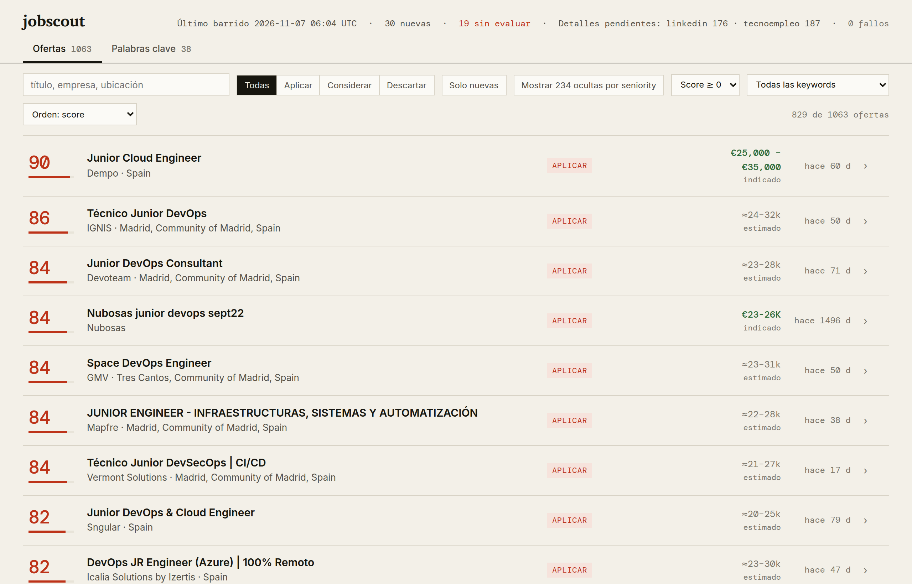
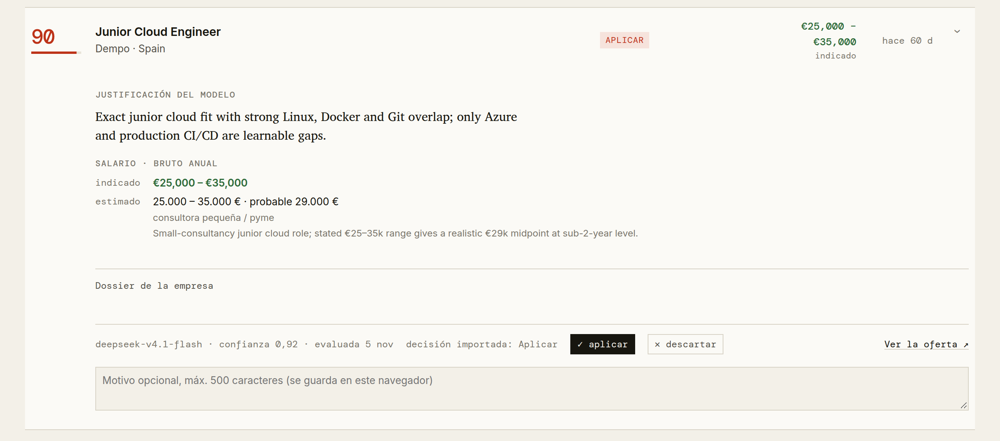

# jobscout

Es una herramienta que me he montado para buscar trabajo de junior en cloud, DevOps o ciberseguridad en Madrid. Recoge ofertas de LinkedIn, Tecnoempleo y GetManfred, quita las repetidas y una IA puntúa cada una de 0 a 100 según mi perfil. Yo leo las mejores y decido a cuáles me presento.

Las candidaturas las envío yo; la herramienta no aplica a nada por su cuenta.

## Cómo funciona

1. **Recoge ofertas.** Cada tres días, a primera hora, mi servidor busca ofertas nuevas en las tres webs con las búsquedas que tengo definidas (por ejemplo, «DevOps junior» o «cloud engineer»).
2. **Quita repetidas y completa.** Si la misma oferta sale en dos sitios, se queda una. Después baja la descripción completa de cada una, porque con el título solo no se puede juzgar.
3. **La IA la puntúa.** Lee la oferta y la compara con mi perfil: el puesto que busco, mi nivel, las tecnologías que sé y lo que descarto. Le pone una nota de 0 a 100 y explica por qué: qué encaja, qué me falta y qué no sabe.
4. **Estima el sueldo** si la oferta no lo pone (ver abajo).
5. **Lo veo todo en un panel.** Una página con las ofertas ordenadas por nota. En cada una marco si aplico o la descarto, y por qué.
6. **Compara con mis decisiones.** Mis «aplico» y «descarto» vuelven a la herramienta, que compara lo que recomendó la IA con lo que decidí yo. Así veo dónde se equivoca.

Así se ve una oferta abierta: la explicación de la nota, el sueldo que pone la oferta y el que estima la IA, y los botones para decidir.

## Por qué está hecha así

**No se presenta a ofertas por mí.** Mandar candidaturas en masa quema empresas que me interesan y suele saltarse las condiciones de las webs. Prefiero pocas candidaturas buenas, cada una revisada por mí.

**Solo mira lo público y va despacio.** No entra con mi cuenta de LinkedIn ni con ninguna otra. Deja unos 8 segundos entre una petición y la siguiente y trae pocas páginas cada vez, para no cargar las webs ni arriesgarme a un bloqueo.

**La IA tiene que explicar su nota.** Un número suelto no me dice si fiarme. Con el porqué al lado veo rápido cuándo acierta y cuándo ha entendido mal la oferta.

**Busca un junior realista.** Penaliza las ofertas que piden 5 años o más, o que son de senior o jefe de equipo. Pero no descarta una oferta porque falten una o dos tecnologías: eso se aprende, y muchas ofertas piden más de lo que luego exigen.

**Mis vetos van aparte de la nota.** Hay cosas que descarto por mi cuenta, como los turnos rotativos. La oferta sale igual, con un aviso, para que el filtro no me esconda algo que quizá sí me interesa.

**El sueldo no cambia la nota.** Si la oferta pone el sueldo, sale tal cual. Si no, la IA estima un rango bruto anual: primero mira qué tipo de empresa es (consultora pequeña, consultora grande, startup, empresa internacional…) y con eso elige una banda según el nivel que piden. Después ajusta por las tecnologías, el inglés, la experiencia y si hay guardias o presencialidad. Para no inventarse cifras, se apoya en la guía salarial de Manfred de 2026 y en las ofertas que sí publican sueldo. Por ejemplo, a un DevOps junior en Devoteam le saca entre 22.000 y 27.000 €. Es solo orientativo: lo separo de la nota para que una oferta no suba solo por pagar más.

**Un modelo de IA barato.** Puntuar miles de ofertas con un modelo caro no tiene sentido para esto. Uso DeepSeek con una suscripción de cuota fija, así el gasto no crece con el número de ofertas.

**Las búsquedas que no dan nada se retiran.** El panel enseña qué búsquedas traen ofertas buenas y cuáles solo traen ruido. Las que no rinden las quito.

**Mis datos se quedan conmigo.** Las ofertas, mi perfil y mi CV se guardan en mi ordenador y en mi servidor. Nada de eso está en este repositorio.

## Qué no hace todavía

- La estimación de sueldo es orientativa: no sustituye a preguntar en la entrevista.
- La IA se equivoca a veces, sobre todo con ofertas mal escritas o muy cortas. Por eso la última palabra es siempre mía.
- Solo mira tres webs.

## Para quien quiera ver el código

Está hecha en Python, con unas 1.300 pruebas automáticas. El manual técnico, con la instalación y todos los comandos, está en [docs/MANUAL.md](docs/MANUAL.md) ([English](docs/MANUAL.en.md)).
